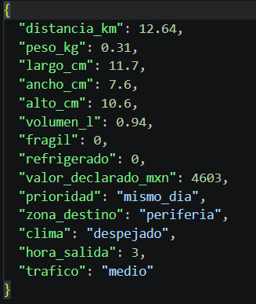
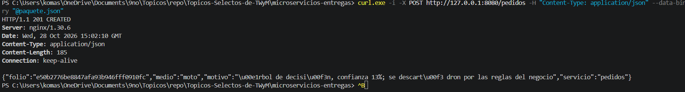
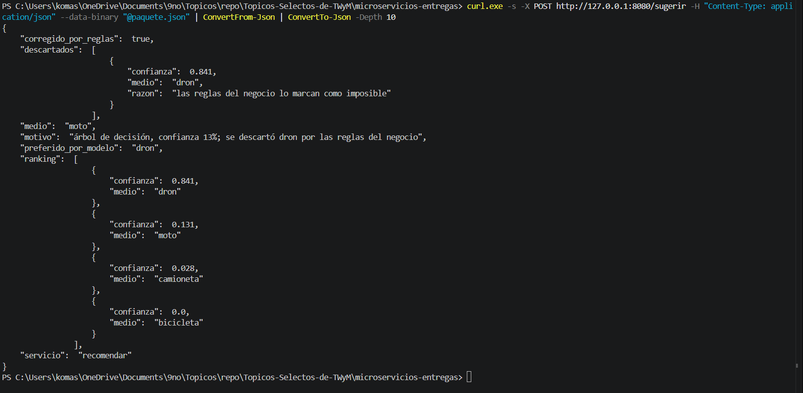
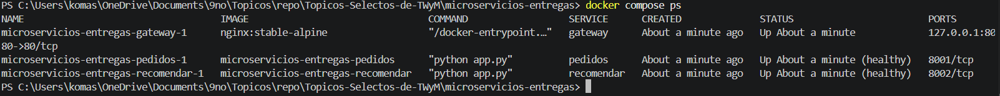
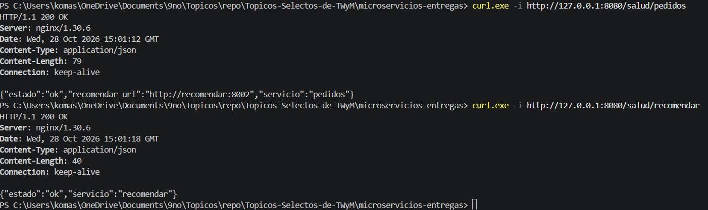
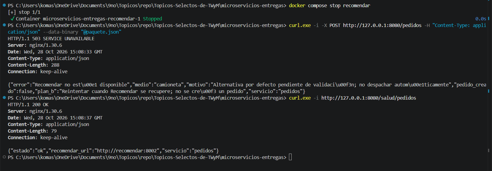
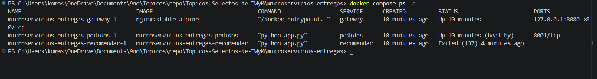
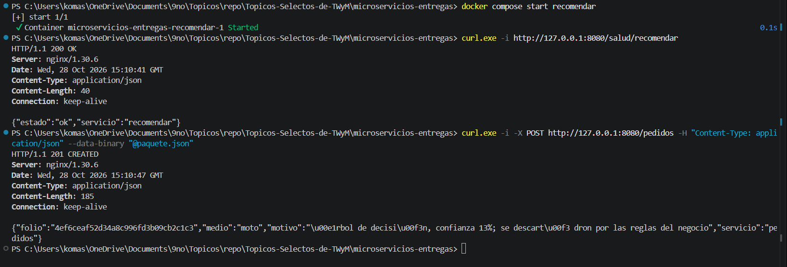

# Actividad — Microservicios con Docker

Nombre: Figueroa Merino Cesar  
Matrícula: 22121299  
Equipo: 6 

## 1. Predicción (hora 3) vs resultado

### Predicción antes de ejecutar

Mi predicción fue que el medio seleccionado sería   moto.

El paquete utilizado tiene estas características:

| Campo | Valor |
|---|---|
| Distancia | 12.64 km |
| Peso | 0.31 kg |
| Largo | 11.7 cm |
| Ancho | 7.6 cm |
| Alto | 10.6 cm |
| Volumen | 0.94 L |
| Frágil | No |
| Refrigerado | No |
| Valor declarado | $4,603 MXN |
| Prioridad | mismo_dia |
| Zona de destino | periferia |
| Clima | despejado |
| Hora de salida | 3 |
| Tráfico | medio |

Según las restricciones de  reglas.py :

- La bicicleta no es viable porque la distancia de 12.64 km supera
  su límite de 7 km.
- El dron no es viable porque las 03:00 corresponden al horario
  nocturno. La regla considera noche cuando la hora es mayor o igual
  a 21 o menor que 6.
- La moto es viable porque el peso, volumen y distancia están dentro
  de sus límites y el paquete no requiere refrigeración.
- La camioneta también cumple las restricciones del paquete.

Predije moto porque el paquete es ligero y su distancia está dentro
del límite permitido para ese medio. Sin embargo, las reglas también
permitían camioneta: la selección final dependía del ranking del modelo.

### Resultado obtenido

Ejecuté:

   
curl.exe -i -X POST http://127.0.0.1:8080/pedidos -H "Content-Type: application/json" --data-binary "@paquete.json"
   

La respuesta fue HTTP 201 CREATED, con estos datos:

- Servicio:  pedidos .
- Folio:  e50b2776be8847afa93b946fff0910fc .
- Medio seleccionado:  moto .
- Motivo:  árbol de decisión, confianza 13%; se descartó dron por las reglas del negocio .

### Ranking y aplicación de reglas

Consulté el resultado detallado mediante:

   
curl.exe -s -X POST http://127.0.0.1:8080/sugerir -H "Content-Type: application/json" --data-binary "@paquete.json" | ConvertFrom-Json | ConvertTo-Json -Depth 10
   

El ranking mostrado fue:

| Posición | Medio | Confianza reportada |
|---|---|---|
| 1 | dron | 0.841, equivalente a 84.1% |
| 2 | moto | 0.131, equivalente a 13.1% |
| 3 | camioneta | 0.028, equivalente a 2.8% |
| 4 | bicicleta | 0.0, equivalente a 0% |

La respuesta indicó:

   json
{
  "preferido_por_modelo": "dron",
  "corregido_por_reglas": true,
  "medio": "moto"
}
   

### Comparación entre predicción y resultado

Mi predicción de moto coincidió con el resultado final.

El modelo prefirió inicialmente dron, con una confianza reportada
de 84.1%. Sin embargo, las reglas lo descartaron porque la hora de
salida era 3 y no se permite utilizar dron durante la noche.

Después se evaluó moto, que ocupaba el segundo lugar del ranking
y cumplía las restricciones. Por eso fue seleccionada.

El motivo de la respuesta muestra 13% porque presenta sin decimales
la confianza asociada a moto.

La lista de descartados contiene únicamente dron. Aunque bicicleta
también era inviable por distancia, el algoritmo dejó de recorrer el
ranking al encontrar moto como primera alternativa viable.

La prueba demuestra que la preferencia del modelo no determina por
sí sola la decisión: las reglas del negocio pueden corregirla.

## 2. docker compose ps (qué hay en cada contenedor)

Utilicé el siguiente comando para comprobar el estado de los servicios:

   
docker compose ps
   

La salida mostró tres contenedores diferentes:

| Contenedor | Imagen | Estado observado |
|---|---|---|
| microservicios-entregas-gateway-1 | nginx:stable-alpine | Up |
| microservicios-entregas-pedidos-1 | microservicios-entregas-pedidos | Up (healthy) |
| microservicios-entregas-recomendar-1 | microservicios-entregas-recomendar | Up (healthy) |

### Contenido y responsabilidad

Gateway: ejecuta Nginx y utiliza  nginx.conf  para dirigir las
solicitudes al servicio correspondiente. Publica el puerto
 127.0.0.1:8080  hacia la computadora.

Pedidos: ejecuta Python, Flask y requests. Recibe el paquete,
consulta a Recomendar mediante HTTP, genera el folio y guarda el
pedido en una lista en memoria. No carga el modelo ni necesita
scikit-learn.

Recomendar: ejecuta Python, Flask y las dependencias científicas.
Contiene  recomendador.py ,  reglas.py  y  modelo_medios.joblib .
Calcula el ranking y selecciona el primer medio viable. No crea
folios ni almacena pedidos.

Pedidos utiliza el puerto interno 8001 y Recomendar el 8002.
Estos puertos no están publicados directamente hacia la computadora.

### Salud de los servicios

Ejecuté:

   
curl.exe -i http://127.0.0.1:8080/salud/pedidos
curl.exe -i http://127.0.0.1:8080/salud/recomendar
   

Ambas solicitudes respondieron HTTP 200 OK.

Pedidos devolvió:

   json
{
  "estado": "ok",
  "recomendar_url": "http://recomendar:8002",
  "servicio": "pedidos"
}
   

Recomendar devolvió:

   json
{
  "estado": "ok",
  "servicio": "recomendar"
}
   

Esto comprobó que ambos servicios podían responder a través del Gateway.

## 3. Fallo al apagar recomendar

### Predicción del fallo

Esperaba que al detener Recomendar, Pedidos y Gateway permanecieran
activos. También esperaba que un nuevo pedido respondiera HTTP 503,
porque Pedidos ya no podría consultar la recomendación.

La ruta de salud de Pedidos debía seguir respondiendo HTTP 200,
ya que no necesita consultar el modelo para indicar que su proceso
está activo.

### Procedimiento y resultado

Detuve únicamente Recomendar:

   
docker compose stop recomendar
   

Después repetí el POST:

   
curl.exe -i -X POST http://127.0.0.1:8080/pedidos -H "Content-Type: application/json" --data-binary "@paquete.json"
   

La respuesta fue HTTP 503 SERVICE UNAVAILABLE:

   json
{
  "error": "Recomendar no está disponible",
  "medio": "camioneta",
  "motivo": "Alternativa por defecto pendiente de validación; no despachar automáticamente",
  "pedido_creado": false,
  "plan_b": "Reintentar cuando Recomendar se recupere; no se creó un pedido",
  "servicio": "pedidos"
}
   

Luego consulté:

   
curl.exe -i http://127.0.0.1:8080/salud/pedidos
   

Pedidos respondió HTTP 200 OK y mantuvo  "estado": "ok" .

La camioneta se devolvió como alternativa pendiente de validación.
No se creó un pedido exitoso ni se confirmó un despacho automático.

### Estado de los contenedores durante el fallo

Ejecuté:

   
docker compose ps -a
   

La salida mostró:

| Servicio | Estado observado |
|---|---|
| gateway | Up 10 minutes |
| pedidos | Up 10 minutes (healthy) |
| recomendar | Exited (137) |

El estado de Recomendar confirma que estaba detenido durante la prueba.
El código de salida 137, por sí solo, no permite determinar la causa
exacta de su terminación.

### Comparación con lo esperado

El comportamiento coincidió con mi predicción.

Pedidos siguió activo y respondió de forma controlada cuando no pudo
consultar a Recomendar. Gateway también permaneció activo y entregó
al cliente la respuesta HTTP 503.

Esto demuestra un fallo parcial: la caída de un servicio no detuvo
todos los procesos, aunque sí impidió completar normalmente una
operación que dependía de él.

### Recuperación

Inicié nuevamente Recomendar:

   
docker compose start recomendar
   

Consulté su salud y recibí HTTP 200 OK:

   json
{
  "estado": "ok",
  "servicio": "recomendar"
}
   

Después repetí el POST y recibí HTTP 201 CREATED, con:

- Folio:  4ef6ceaf52d34a8c996fd3b09cb2c1c3 .
- Medio:  moto .
- Motivo:  árbol de decisión, confianza 13%; se descartó dron por las reglas del negocio .

La creación de pedidos se recuperó sin reiniciar Pedidos ni Gateway.
El nuevo folio demuestra que se creó otra solicitud exitosa después
de recuperar Recomendar.

## 4. Réplicas de la etapa 5 vs esto

Las réplicas del monolito ejecutan varias instancias de la misma
aplicación. Cada instancia mantiene las mismas responsabilidades,
código y dependencias.

Ejecutar tres copias del mismo Django puede ayudar a distribuir
solicitudes, pero no separa la creación de pedidos de la recomendación.

En esta práctica existen aplicaciones con responsabilidades diferentes:

- Pedidos administra la creación del pedido.
- Recomendar ejecuta el modelo y aplica las reglas.
- Gateway proporciona el punto de entrada para el cliente.

Pedidos y Recomendar se ejecutan en procesos separados, utilizan
dependencias distintas y se comunican por HTTP. Sus imágenes pueden
reconstruirse de forma independiente.

La prueba de fallo mostró esta separación: Recomendar quedó detenido
mientras Pedidos y Gateway continuaron activos.

Tener varios contenedores no basta por sí solo para demostrar
microservicios. La diferencia está en separar responsabilidades
y permitir despliegues independientes.

## 5. Camino de un POST /pedidos (red vs import)

El recorrido de la solicitud es:

   text
Cliente
   |
   | HTTP: POST http://127.0.0.1:8080/pedidos
   v
Gateway: Nginx
   |
   | HTTP: http://pedidos:8001/pedidos
   v
Pedidos
   |
   | HTTP: http://recomendar:8002/sugerir
   v
Recomendar
   |
   | Llamadas locales dentro de Python
   v
recomendador.py
   |
   +--> Crea un DataFrame con los 14 campos
   |
   +--> Ejecuta predict_proba del modelo
   |
   +--> Ordena el ranking
   |
   +--> Consulta es_posible en reglas.py
   |
   v
Devuelve medio y motivo
   

La respuesta regresa a Pedidos. Este servicio genera el folio, guarda
el pedido en su lista en memoria y devuelve el resultado al cliente
a través del Gateway.

### Comunicación por red

Los enlaces cliente → Gateway, Gateway → Pedidos y Pedidos →
Recomendar utilizan HTTP.

Pedidos obtiene la dirección del otro servicio mediante:

   text
RECOMENDAR_URL=http://recomendar:8002
   

Dentro de la red de Compose,  recomendar  es el nombre de host
del servicio.

### Imports y llamadas locales

Dentro de Recomendar,  app.py  importa el recomendador. El recomendador
carga el modelo mediante joblib y llama a  es_posible  de  reglas.py .

La ejecución del modelo y de las reglas ocurre dentro del mismo proceso
de Recomendar. Esos pasos no utilizan HTTP.

Pedidos no importa el recomendador ni abre el archivo  .joblib ;
solicita esa funcionalidad a través de la API.

## 6. Si solo cambia el .joblib, ¿qué reconstruyen?

En esta configuración, el modelo está incluido dentro de la imagen
de Recomendar porque su Dockerfile contiene:

   dockerfile
COPY entregas ./entregas
   

La carpeta copiada incluye:

   text
entregas/modelo/modelo_medios.joblib
   

Si reemplazo ese archivo por un modelo compatible, debo reconstruir
y recrear Recomendar:

   
docker compose up -d --build recomendar
   

Pedidos y Gateway no necesitan reconstruirse si su código permanece
igual y la API conserva los mismos campos de entrada y salida.

El nuevo modelo debe ser compatible con el preprocesamiento y las
dependencias del servicio. El modelo utilizado en esta práctica
corresponde a scikit-learn 1.9.0.

### Comparación con el monolito Django

En el proyecto original, el modelo se encuentra dentro del proyecto
Django y el Dockerfile copia la aplicación completa.

Por tanto, con esa configuración, cambiar el modelo requiere
reconstruir y desplegar la imagen del monolito que lo contiene.

En esta versión, la actualización se limita a Recomendar.
Esto permite actualizar el componente de recomendación sin
reconstruir el servicio que crea los pedidos.

## 7. Dos límites de esta práctica antes de producción

### 1. Almacenamiento de pedidos en memoria

Pedidos guarda la información en una lista de Python. Si el proceso
se reinicia, los pedidos almacenados se pierden.

Además, si se ejecutan varias instancias de Pedidos, cada una
mantendrá una lista independiente y no compartirán automáticamente
la información.

Antes de producción faltaría un almacenamiento persistente compartido,
por ejemplo una base de datos, para conservar los pedidos y permitir
su consulta desde diferentes instancias.

### 2. Servidor de desarrollo de Flask

Los servicios se ejecutan mediante  app.run , utilizando el servidor
de desarrollo de Flask.

Esta configuración permite realizar las pruebas de la actividad,
pero falta un despliegue adecuado para producción.

Sería necesario utilizar un servidor WSGI de producción y configurar
su operación, incluyendo trabajadores, tiempos de espera y supervisión
del proceso.

## 8. ¿En qué se parece y en qué no el HTML al del monolito Django?
El HTML conserva el diseño del monolito: los 14 campos del paquete, los botones de ejemplo para noche y tarde y la presentación del resultado.

La diferencia está en cómo funciona. En el monolito, Django procesaba la plantilla y el formulario enviaba la solicitud a /entregas/recomendar/. En los microservicios, Nginx sirve el HTML como archivo estático y el navegador envía POST /pedidos únicamente al Gateway.

La versión actual muestra folio, medio y motivo. Además, utiliza únicamente el árbol; no incluye la selección funcional de bosque y red ni el proceso detallado del monolito. Las etiquetas de plantilla de Django se eliminaron porque Nginx no las interpreta.

## 9. Misma hora 3 con árbol, bosque y red: ¿coincidieron?
No pude determinar si los tres modelos coincidieron porque la versión implementada de microservicios utiliza únicamente el árbol de decisión. Bosque y red no se ejecutaron en esta prueba.

Con hora de salida 3, el árbol prefirió inicialmente dron, con una confianza reportada de 84.1%. Las reglas descartaron esa opción por ser horario nocturno y seleccionaron moto, que tenía 13.1% y cumplía las restricciones.

Las mismas reglas impedirían seleccionar dron con bosque y red, aunque lo colocaran primero. Sin embargo, eso no garantiza que ambos terminaran eligiendo moto: para conocer si coincidieron habría que ejecutar los tres modelos con exactamente el mismo paquete.